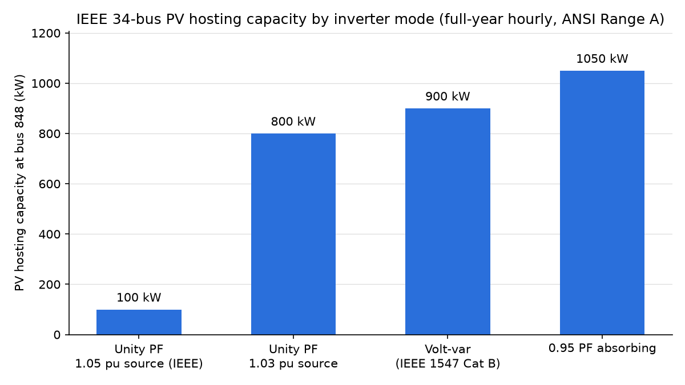
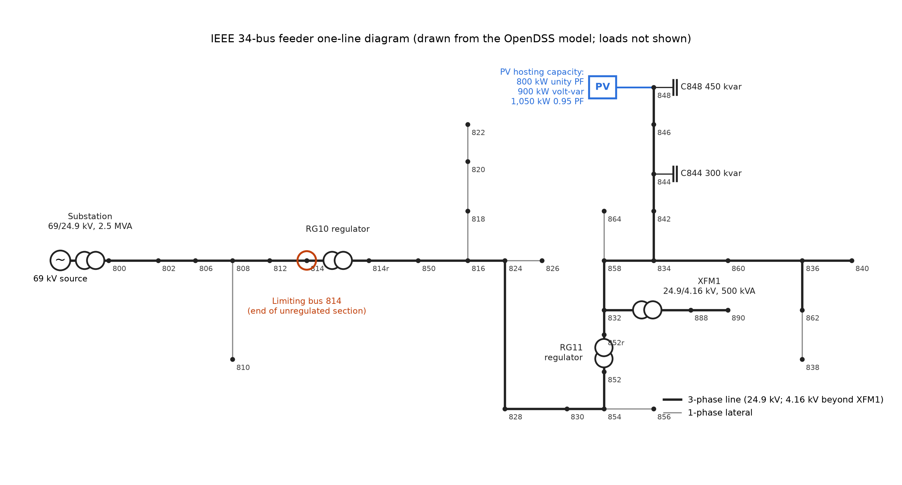

# DER Interconnection & PV Hosting Capacity Study — IEEE 34-Bus Feeder

Full-year, hourly PV hosting capacity study on the IEEE 34-node test feeder using OpenDSS (via OpenDSSDirect.py), with IEEE 1547-2018 smart inverter functions, a fault study, and interconnection screens.

**Author:** Mahedi Hasan, Electrical Engineering senior, The City College of New York (CCNY)

**Full technical report (18 pages):** [report/ieee34_hosting_capacity_report.pdf](report/ieee34_hosting_capacity_report.pdf)


## Key results

|Case (PV at bus 848)|Hosting capacity|Limit|
|-|-|-|
|Unity power factor|**800 kW**|1.0510 pu at bus 814 (850 kW, Apr 2 noon)|
|IEEE 1547-2018 Cat B volt-var|**900 kW** (+12.5%)|1.0501 pu at bus 814 (950 kW, Apr 9 noon)|
|Constant 0.95 PF, absorbing|**1,050 kW** (+31%)|1.0505 pu at bus 814 (1,100 kW, Apr 2 noon)|
|Unity PF, IEEE's original 1.05 pu source|100 kW|1.0504 pu at bus 814 (150 kW, Nov 23, 1 PM)|

* **Validation:** bus voltages match IEEE published results within **0.14%** (mean 0.06%, 92/92 bus-phases within 1%) with regulator taps matched; substation kW within 0.6%.
* **Limiting factor:** overvoltage at bus 814, the end of the 20-mile unregulated section before regulator RG10. Thermal loading never exceeded 91.9%.
* **Fault study:** PV (1.2 × rated current) raises the 3-phase fault current at bus 848 from 247.8 A to at most 280.6 A. All sizes fail the 10% fault-current and 15%-of-peak-load (265 kW) fast-track screens, which is why a detailed study is needed.





## Method

1. **Model:** EPRI OpenDSS `ieee34Mod1.dss` (24.9 kV, 58.4 mi of line, 1,769 kW load, two line regulators, two capacitors).
2. **Validation:** per-bus comparison with IEEE's published power flow, with OpenDSS auto taps and with IEEE's published taps (RG10 12/5/5, RG11 13/11/12).
3. **Time series:** 8,760-hour EPRI load shape (`PaperLoadShape.txt`) and PVWatts V8 hourly PV output for Tucson, AZ (NSRDB TMY, 1,788 kWh/kWdc). All 4,264 daylight hours are solved for each PV size.
4. **Hosting capacity:** PV size swept in 50 kW steps; a size passes if no hour has any node above 1.05 pu (ANSI C84.1 Range A) or any line/transformer above 100% rating.
5. **Smart inverters:** IEEE 1547-2018 Category B volt-var (0.92/0.98/1.02/1.08 pu ↔ +44/0/0/−44% of kVA) and constant 0.95 PF; inverter kVA = 1.12 × kW.
6. **Fault study:** OpenDSS fault study at peak load, taps frozen; inverter fault current assumed 1.2 × rated; screens per Arizona Admin. Code R14-2-2615 (same as FERC SGIP fast track).

### Key assumptions

* Substation source set to **1.03 pu**. IEEE's 1.05 pu (a peak-load setting) puts bus 814 at 1.0528 pu at minimum load with no PV. Results at 1.05 pu are reported for comparison.
* Existing undervoltages (814 A ≈ 0.947 pu, 890 ≈ 0.92 pu at peak) are excluded because PV cannot worsen them.
* Line ratings from standard ACSR ampacities (1/0: 230 A, #2: 180 A, #4: 140 A); the IEEE model leaves them at a 400 A placeholder.

## Repository layout

|Path|What it is|
|-|-|
|`run_powerflow.py`|Step 1: first power flow (convergence, totals, min/max voltage)|
|`compare_ieee.py`|Step 2: validation vs IEEE (`python compare_ieee.py ieee` locks IEEE taps)|
|`hosting_capacity.py`|Steps 3–4: yearly hosting capacity sweep (unity / `vv` / `pf95`)|
|`make_fig_step4.py`|Step 4: hosting capacity summary figure|
|`fault_study.py`|Step 5: fault currents and interconnection screens|
|`one_line.py`|Step 6: one-line diagram drawn from the OpenDSS model (PNG + PDF)|
|`34Bus/`|EPRI OpenDSS IEEE 34-bus model files|
|`profiles/`|Hourly load shape and PVWatts PV profile|
|`ieee_published/`|IEEE feeder data and extracted published voltages|
|`results_*.csv`, `fig_*.png`|Outputs of each step|

## How to reproduce (Windows, Python 3.12)

```
py -3.12 -m venv .venv
.venv\Scripts\Activate.ps1
pip install -r requirements.txt

python run_powerflow.py
python compare_ieee.py
python compare_ieee.py ieee
python hosting_capacity.py                   # unity PF, 1.03 pu source
python hosting_capacity.py 848 1.03 50 vv    # IEEE 1547 volt-var
python hosting_capacity.py 848 1.03 50 pf95  # 0.95 PF absorbing
python hosting_capacity.py 848 1.05          # IEEE's 1.05 pu source
python make_fig_step4.py
python fault_study.py
python one_line.py
```

Each hosting capacity run takes about 20–50 s.

## Tools and standards

OpenDSS 11.0.0.1 · OpenDSSDirect.py 0.9.4 · Python 3.12 · pandas · matplotlib · IEEE 1547-2018 · ANSI C84.1 · IEEE PES Distribution Test Feeders

## References

1. IEEE PES Distribution Test Feeder Working Group, IEEE 34 Node Test Feeder — https://cmte.ieee.org/pes-testfeeders/resources
2. IEEE Std 1547-2018; ANSI C84.1
3. PVWatts V8, National Laboratory of the Rockies (formerly NREL)
4. W. H. Kersting, *Distribution System Modeling and Analysis*
5. Arizona Admin. Code R14-2-2615 (interconnection screens)

